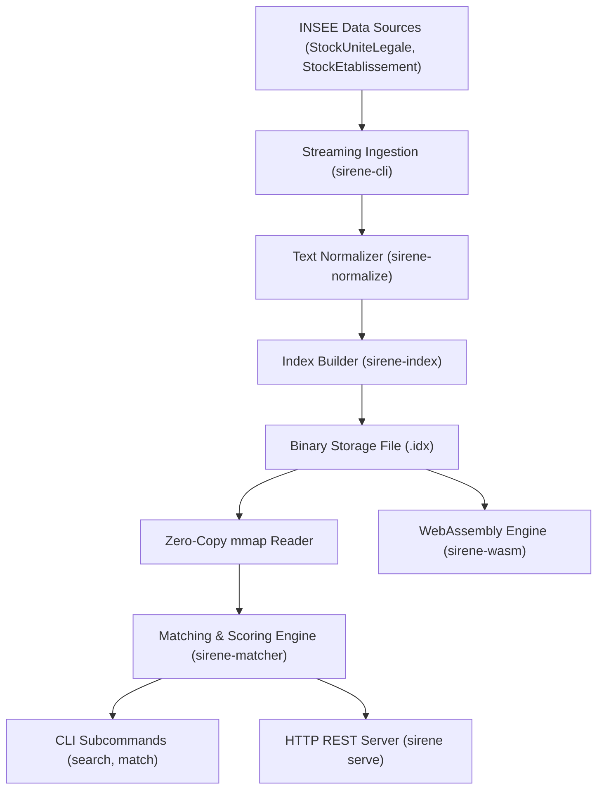

# Architecture & Storage

`sirene-rs` is designed for ultra-low latency, deterministic scoring, and portability across native platforms and WebAssembly runtimes.

---

## 🏗️ Design Overview

---

## 💾 Compact Inverted Index Design

Rather than maintaining a heavy Lucene or Elasticsearch cluster, `sirene-rs` packs index data into a compact binary format:

1. **Finite State Transducers (FST)**:
   - Indexes all normalized enterprise tokens and 3-grams.
   - Lookups execute in $O(L)$ time where $L$ is query token length, independent of dictionary size.
2. **Roaring Bitmaps**:
   - Compresses document posting lists and categorical filters.
   - Enables ultra-fast bitwise intersections (`AND`, `OR`, `ANDNOT`) for department filters and active status.
3. **Memory-Mapped Storage (`memmap2`)**:
   - The OS manages paging into memory directly from disk.
   - Multiple worker threads share the exact same physical pages without locking or copying.

---

## 🔒 Zero C / C++ Dependencies

All dependencies are written in pure Rust:
- **No C compiler required** during build.
- **Portability**: Compiles cleanly to `wasm32-unknown-unknown` for browser and edge runtime execution.
- **Security**: No C memory safety hazards.
